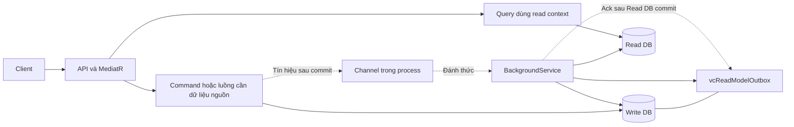
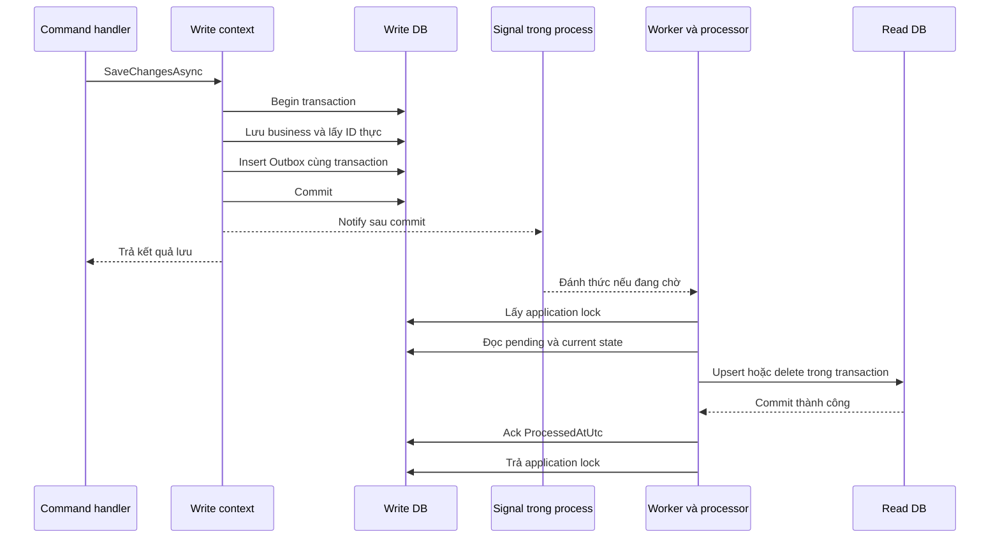

# Tách database đọc/ghi và cơ chế đồng bộ dữ liệu

Ngày đối chiếu source: **21/10/2026**. Ngôn ngữ tài liệu: `vi-VN`.

Tài liệu giải thích cách triển khai **đang có trong repository**: từ cấu hình kết nối, định tuyến Command/Query, bắt thay đổi ở Write DB, đến worker đồng bộ sang Read DB, retry và xác nhận Outbox. Các ví dụ dữ liệu và tên database dưới đây là minh họa, không phải thông tin kết nối của môi trường đang chạy.

Phạm vi được đối chiếu gồm hai commit `6e2586a` — `feat(api): tách db` và `20c566d` — `feat(api): tối ưu đồng bộ dữ liệu 2 db`, cùng source/test tại thời điểm viết. README và tài liệu trong `docs/plans/cqrs-database-split/` được dùng làm bối cảnh; khi mô tả cũ khác source hiện tại, tài liệu này ưu tiên source hiện tại. Không tìm thấy thư mục `llm-wiki/` trong project.

Đây là tài liệu từ việc đọc source và test, không phải biên bản xác nhận hai SQL Server database thực tế đã triển khai hoặc đang đồng bộ thành công. Trong lần viết tài liệu này không chạy API, test, migration hay câu lệnh truy cập database.

## Mục lục

1. [Bức tranh tổng thể](#1-bức-tranh-tổng-thể)
2. [Thay đổi so với kiến trúc trước đây](#2-thay-đổi-so-với-kiến-trúc-trước-đây)
3. [Bản đồ source và trách nhiệm](#3-bản-đồ-source-và-trách-nhiệm)
4. [Cấu hình và kiểm tra khi khởi động](#4-cấu-hình-và-kiểm-tra-khi-khởi-động)
5. [Định tuyến đọc và ghi thực tế](#5-định-tuyến-đọc-và-ghi-thực-tế)
6. [Outbox lưu gì và nằm ở đâu](#6-outbox-lưu-gì-và-nằm-ở-đâu)
7. [Bắt thay đổi khi SaveChanges](#7-bắt-thay-đổi-khi-savechanges)
8. [Đánh thức worker sau commit](#8-đánh-thức-worker-sau-commit)
9. [Vòng đời worker và dependency injection](#9-vòng-đời-worker-và-dependency-injection)
10. [Xử lý một batch và khóa nhiều instance](#10-xử-lý-một-batch-và-khóa-nhiều-instance)
11. [Đọc trạng thái mới nhất từ Write DB](#11-đọc-trạng-thái-mới-nhất-từ-write-db)
12. [Sinh SQL và áp dụng dữ liệu sang Read DB](#12-sinh-sql-và-áp-dụng-dữ-liệu-sang-read-db)
13. [Ack Outbox và bảo đảm nhất quán](#13-ack-outbox-và-bảo-đảm-nhất-quán)
14. [Ví dụ xuyên suốt](#14-ví-dụ-xuyên-suốt)
15. [Xử lý lỗi, cancellation và phục hồi](#15-xử-lý-lỗi-cancellation-và-phục-hồi)
16. [Thư viện và kỹ thuật sử dụng](#16-thư-viện-và-kỹ-thuật-sử-dụng)
17. [Điều kiện triển khai và vận hành](#17-điều-kiện-triển-khai-và-vận-hành)
18. [Các giới hạn cần hiểu chính xác](#18-các-giới-hạn-cần-hiểu-chính-xác)
19. [Các test đang có và ý nghĩa](#19-các-test-đang-có-và-ý-nghĩa)
20. [Thứ tự đọc code và thuật ngữ](#20-thứ-tự-đọc-code-và-thuật-ngữ)

## 1. Bức tranh tổng thể

Hệ thống dùng CQRS ở tầng xử lý request và tách hai SQL Server database:

- **Write DB** là nguồn dữ liệu chính, nơi command đọc dữ liệu để kiểm tra nghiệp vụ và lưu thay đổi. Outbox cũng nằm trong database này.
- **Read DB** chứa bản sao các bảng nghiệp vụ để phục vụ các query sử dụng read context và các stored procedure đọc được định tuyến tới đây.
- **Worker đồng bộ** chạy bên trong process API, đọc Outbox tại Write DB, đọc lại trạng thái bản ghi ở Write DB, rồi ghi trạng thái đó sang Read DB.

Hướng đồng bộ là **Write DB → Read DB**. Read DB không đồng bộ ngược về Write DB.



Tách đọc/ghi được thực hiện bằng **hai DbContext được inject vào handler**. Không có middleware tự phân loại theo HTTP GET/POST, cũng không có MediatR behavior tự chọn DB dựa trên tên `Command` hay `Query`.

Cơ chế đồng bộ là **Transactional Outbox + worker tự viết + projection trạng thái hiện tại**. Source đồng bộ không dùng SQL Server Replication, CDC, Always On, Kafka, RabbitMQ, Debezium hoặc một thư viện Outbox bên ngoài. Hangfire có trong ứng dụng nhưng worker đồng bộ này sử dụng `BackgroundService`, không chạy dưới dạng Hangfire job.

### 1.1. Độ nhất quán được bảo đảm đến đâu?

Write DB và Outbox được ghi nguyên tử trong một transaction tại Write DB. Tuy nhiên, Write DB và Read DB không commit chung một transaction. Sau khi command thành công, Read DB có thể chưa được cập nhật.

Mô hình này là **eventual consistency**: khi đường ghi được capture đầy đủ, worker hoạt động, schema/quyền hợp lệ, không còn message lỗi chặn xử lý và các thay đổi tiếp tục được xử lý, Read DB hội tụ về trạng thái nguồn. Đây không phải bảo đảm đọc thấy ngay dữ liệu vừa ghi.

### 1.2. “Read DB” vẫn có thao tác ghi

Tên Read DB nói về vai trò đối với phần nghiệp vụ đọc. Projector vẫn cần `INSERT`, `UPDATE`, `DELETE` trên database này để cập nhật bản sao. `ReadConnection` hiện dùng chung cho query và projector, vì vậy tài khoản kết nối này không thể chỉ có quyền `SELECT` nếu muốn đồng bộ hoạt động.

## 2. Thay đổi so với kiến trúc trước đây

Trước commit tách DB, `Program.cs` đã đăng ký hai DbContext nhưng cả hai cùng lấy `DefaultConnection`. Việc có hai class context lúc đó chỉ là phân tách trong code, chưa tạo ra hai đích database khác nhau.

| Nội dung | Trước khi tách | Source hiện tại |
| --- | --- | --- |
| Write context | `DefaultConnection` | `WriteConnection`, có fallback legacy |
| Read context | `DefaultConnection` | `ReadConnection`, mặc định `NoTracking` qua DI |
| Đăng ký DB | Trực tiếp hai `AddDbContext` trong `Program.cs` | `AddClinicDatabases` và kiểm tra cấu hình tập trung |
| Thay đổi nghiệp vụ | Chỉ lưu business | Khi bật đồng bộ: business và Outbox cùng transaction |
| Đồng bộ | Không có worker Outbox | Worker đọc pending, ghi replica, sau đó ack |
| Kiểm tra token | Read context | Write context để dùng dữ liệu nguồn |
| Stored procedure | Cùng `DefaultConnection` | Chọn read/write theo mục đích từng hàm |
| Hangfire storage | `DefaultConnection` | Write connection |
| Cache query | Theo `EnableCache` | Bypass `GetOrCreate`/`Set` khi đồng bộ bật |

Commit tối ưu sau đó bổ sung tín hiệu sau commit và đổi worker để xử lý batch kế tiếp ngay khi vừa xử lý được dữ liệu. Worker không còn chủ động nghỉ một chu kỳ polling sau mỗi batch thành công.

Một số điểm không phải mới được tạo trong hai commit này: read context, nhiều command/query đã inject đúng context, entity và phần lớn xử lý nghiệp vụ. Thay đổi kết nối khiến việc phân tách context có tác dụng đối với database vật lý.

## 3. Bản đồ source và trách nhiệm

Các liên kết tương đối trong tài liệu được tính từ `VeterinaryClinic.Data/Synchronization/`.

### 3.1. Cấu hình và điểm tích hợp

| File | Trách nhiệm |
| --- | --- |
| [Program.cs](../../VeterinaryClinic.API/Program.cs) | Đăng ký DB, MediatR, cache, Hangfire, SignalR và gọi seeder |
| [appsettings.json.example](../../VeterinaryClinic.API/appsettings.json.example) | Ví dụ cấu hình hai kết nối và options đồng bộ |
| [DatabaseConnectionSettings.cs](../../VeterinaryClinic.Shared/Configurations/DatabaseConnectionSettings.cs) | Resolve read/write connection, tương thích `DefaultConnection` |
| [DatabaseServiceExtensions.cs](../../VeterinaryClinic.Infrastructure/Configurations/DatabaseServiceExtensions.cs) | Validate cấu hình, đăng ký hai context, bật dịch vụ đồng bộ |
| [VeterinaryClinicDataContext.cs](../Systems/DataContext/VeterinaryClinicDataContext.cs) | Write context, audit, Outbox và interceptor commit |
| [VeterinaryClinicReadDataContext.cs](../Systems/DataContext/VeterinaryClinicReadDataContext.cs) | Mô hình entity dùng để query và xác định các bảng được projection |
| [VeterinaryClinicCallStoreHelperHandler.cs](../../VeterinaryClinic.Business/StoredProcedures/VeterinaryClinicCallStoreHelperHandler.cs) | Định tuyến ba stored procedure qua ADO.NET |
| [CheckTokenQueries.cs](../../VeterinaryClinic.Business/Business/Authorizations/AuthorizationQueries/CheckTokenQueries.cs) | Kiểm tra người dùng hiện tại từ Write DB |
| [RedisCacheService.cs](../../VeterinaryClinic.Business/Services/CacheService/RedisCacheService.cs) | Bypass cache đọc khi sync bật |

### 3.2. Bắt thay đổi tại tầng Data

| File | Trách nhiệm |
| --- | --- |
| [ReadModelSynchronizationOptions.cs](ReadModelSynchronizationOptions.cs) | `Enabled`, `PollIntervalSeconds`, `BatchSize` |
| [ReadModelOutboxMessage.cs](ReadModelOutboxMessage.cs) | Entity lưu yêu cầu đồng bộ |
| [ReadModelOutboxCapture.cs](ReadModelOutboxCapture.cs) | Bao transaction/savepoint, lưu business, ghi khóa entity vào Outbox |
| [OutboxEntrySnapshot.cs](OutboxEntrySnapshot.cs) | Chụp và khôi phục trạng thái ChangeTracker khi lần lưu thất bại |
| [IReadModelSynchronizationSignal.cs](IReadModelSynchronizationSignal.cs) | Hợp đồng đánh thức worker |
| [ReadModelOutboxTransactionInterceptor.cs](ReadModelOutboxTransactionInterceptor.cs) | Chỉ báo khi transaction đã capture Outbox commit thực tế |

### 3.3. Xử lý đồng bộ tại tầng Infrastructure

| File | Trách nhiệm |
| --- | --- |
| [ReadModelSynchronizationServiceCollectionExtensions.cs](../../VeterinaryClinic.Infrastructure/Synchronization/ReadModelSynchronizationServiceCollectionExtensions.cs) | Đăng ký signal, store, processor, hosted worker |
| [ReadModelSynchronizationSignal.cs](../../VeterinaryClinic.Infrastructure/Synchronization/ReadModelSynchronizationSignal.cs) | Channel dung lượng một, gộp tín hiệu trong bộ nhớ |
| [ReadModelSynchronizationWorker.cs](../../VeterinaryClinic.Infrastructure/Synchronization/ReadModelSynchronizationWorker.cs) | Vòng lặp xử lý, chờ tín hiệu/polling, log và backoff khi lỗi |
| [ReadModelOutboxProcessor.cs](../../VeterinaryClinic.Infrastructure/Synchronization/ReadModelOutboxProcessor.cs) | Điều phối đúng thứ tự lock → đọc → apply → ack → unlock |
| [IReadModelProjectionStore.cs](../../VeterinaryClinic.Infrastructure/Synchronization/IReadModelProjectionStore.cs) | Hợp đồng store và record `ReadModelProjectionState` |
| [RelationalReadModelProjectionStore.cs](../../VeterinaryClinic.Infrastructure/Synchronization/RelationalReadModelProjectionStore.cs) | Hiện thực đọc nguồn, transaction replica và ack |
| [ReadModelProjectionSql.cs](../../VeterinaryClinic.Infrastructure/Synchronization/ReadModelProjectionSql.cs) | Validate metadata, sinh SQL có parameter, xử lý identity |
| [SqlServerReadModelConsumerLock.cs](../../VeterinaryClinic.Infrastructure/Synchronization/SqlServerReadModelConsumerLock.cs) | Khóa consumer bằng SQL Server application lock và cleanup session |

## 4. Cấu hình và kiểm tra khi khởi động

### 4.1. Cấu hình hai database

Đoạn cấu hình sau dùng tên DB trong file mẫu; chỉ dùng giá trị minh họa, không chứa credential thật:

```json
{
  "ConnectionStrings": {
    "WriteConnection": "Server=.;Database=VeterinaryClinicWriteDb;Integrated Security=True;MultipleActiveResultSets=False;TrustServerCertificate=True",
    "ReadConnection": "Server=.;Database=VeterinaryClinicReadDb;Integrated Security=True;TrustServerCertificate=True"
  },
  "ReadModelSynchronization": {
    "Enabled": true,
    "PollIntervalSeconds": 5,
    "BatchSize": 100
  }
}
```

Hai DB có thể cùng SQL Server instance hoặc khác server, miễn đích vật lý thực sự khác nhau và ứng dụng có thể kết nối đến cả hai. Thay username mà giữ nguyên server/database không tạo ra một replica riêng.

`ReadModelSynchronizationOptions` có mặc định:

| Option | Mặc định trong class | Ý nghĩa |
| --- | --- | --- |
| `Enabled` | `false` | Bật capture Outbox và đăng ký các dịch vụ đồng bộ |
| `PollIntervalSeconds` | `5` | Timeout khi rỗng và khoảng nghỉ khi lỗi |
| `BatchSize` | `100` | Số message Outbox tối đa mỗi lượt |

File mẫu đặt `Enabled=true`, khác với giá trị mặc định của class. Sự tồn tại của file mẫu không chứng minh cấu hình có hiệu lực của process đang chạy.

### 4.2. Resolve connection string

`DatabaseConnectionSettings` xử lý riêng từng phía:

```text
GetWriteConnectionString:
    WriteConnection có giá trị → dùng WriteConnection
    nếu trống/thiếu → dùng DefaultConnection
    vẫn trống/thiếu → ném InvalidOperationException

GetReadConnectionString:
    ReadConnection có giá trị → dùng ReadConnection
    nếu trống/thiếu → dùng DefaultConnection
    vẫn trống/thiếu → ném InvalidOperationException
```

Fallback phục vụ cấu hình cũ một DB. Khi bật đồng bộ, validator còn yêu cầu cả `WriteConnection` và `ReadConnection` phải được khai báo trực tiếp; không cho fallback che việc thiếu một phía.

### 4.3. `AddClinicDatabases` làm gì?

`Program.cs` gọi `builder.Services.AddClinicDatabases(builder.Configuration)`. Extension lần lượt:

1. Resolve hai kết nối bằng helper trên.
2. Bind section `ReadModelSynchronization` vào options để kiểm tra.
3. Gọi `Validate` trước khi đăng ký các dịch vụ DB.
4. Đăng ký `IOptions<ReadModelSynchronizationOptions>`.
5. Đăng ký write context với `UseSqlServer(writeConnection)`.
6. Đăng ký read context với `UseSqlServer(readConnection)` và `UseQueryTrackingBehavior(NoTracking)`.
7. Nếu `Enabled=true`, gọi `AddReadModelSynchronization`.

Đăng ký DI và validate chuỗi kết nối không mở DB để kiểm tra bảng, quyền hoặc khả năng truy cập mạng. Cấu hình hợp lệ về cú pháp vẫn có thể gặp lỗi runtime khi worker hoặc request mở kết nối.

### 4.4. Các điều kiện bị từ chối

| Điều kiện | Hành vi |
| --- | --- |
| Chuỗi không parse được bằng `SqlConnectionStringBuilder` | Báo chuỗi SQL Server không hợp lệ |
| Thiếu `Server` hoặc `Database` ở một phía | Từ chối cấu hình |
| `Enabled=false` nhưng hai đích server/catalog khác nhau | Yêu cầu bật đồng bộ |
| `Enabled=true` nhưng thiếu kết nối explicit | Yêu cầu đủ read/write connection |
| `Enabled=true` và hai đích server/catalog giống nhau | Yêu cầu hai database khác nhau |
| `Enabled=true` và Write connection bật MARS | Từ chối vì yêu cầu savepoint |
| `Enabled=true`, polling ngoài khoảng 1–3600 | Từ chối |
| `Enabled=true`, batch ngoài khoảng 1–1000 | Từ chối |

So sánh cùng DB dựa vào `DataSource.Trim()` và `InitialCatalog.Trim()`, không phân biệt hoa/thường. Validator không phân giải DNS, alias, listener hoặc các cách viết server khác nhau nhưng cùng trỏ một SQL Server. Đây là giới hạn của phép kiểm tra cấu hình, không phải xác nhận hai đích vật lý.

MARS là `MultipleActiveResultSets`. Capture cần rollback riêng một lần save trong transaction caller bằng savepoint; vì vậy source yêu cầu tắt MARS trên Write connection khi bật đồng bộ. Không có guard tương tự cho Read connection.

### 4.5. Chế độ một DB còn được hỗ trợ

Chỉ có `DefaultConnection`, không khai báo section sync hoặc đặt `Enabled=false`: cả hai context resolve cùng đích; write context audit/lưu bình thường, không capture, không đăng ký worker/signal. Đường lưu nghiệp vụ khi đó không đòi bảng Outbox tồn tại.

Options capture được đọc vào `_captureOutbox` khi tạo write context; worker dùng `IOptions`, không có cơ chế hot reload bật/tắt toàn bộ kiến trúc trong process đang chạy. Khi đổi chế độ cần coi đây là thay đổi cấu hình triển khai và khởi động lại ứng dụng theo quy trình vận hành.

## 5. Định tuyến đọc và ghi thực tế

### 5.1. Hai context quyết định đích truy cập

`VeterinaryClinicDataContext` có thể đọc và ghi. Các command dùng context này để kiểm tra trùng mã, điều kiện trạng thái, số liệu thanh toán hoặc dữ liệu liên quan trước khi thay đổi. Nếu kiểm tra nghiệp vụ dùng replica đang trễ thì quyết định có thể sai, nên đường command cần dữ liệu nguồn.

`VeterinaryClinicReadDataContext` là context dành cho các query đọc. `NoTracking` được đặt trong đăng ký DI để EF không giữ trạng thái entity sau khi query mặc định. `AsNoTracking()` trong nhiều handler vẫn hợp lệ dù DI đã đặt mặc định này.

**`NoTracking` không phải khóa cấm ghi.** Read context không override `SaveChanges` để ném lỗi. Quyền SQL Server và cách sử dụng trong code mới quyết định có thể ghi hay không. Projector dùng SQL trực tiếp trên connection của một read context riêng.

### 5.2. Nhóm luồng sử dụng từng phía

| Luồng | Phía sử dụng | Bằng chứng/cách hoạt động |
| --- | --- | --- |
| Các command CRUD nghiệp vụ | Write DB | Inject `VeterinaryClinicDataContext`, gọi `SaveChanges`/`SaveChangesAsync` |
| Query danh sách/chi tiết thông thường | Read DB | Inject `VeterinaryClinicReadDataContext` |
| `CheckTokenQueryHandler` | Write DB | Đọc `VcUsers.AsNoTracking()` theo UserId hiện tại |
| `VerifyEmailQuery` | Write DB | Có thay đổi `IsActive`, xóa verification token và lưu |
| `GenerateBillPdfQuery` | Write DB | Join bill, customer, invoice, appointment, service và pet từ write context |
| `GeneratePdfForAppointmentQuery` | Write DB | Đọc invoice; có thể gửi tiếp `GenerateBillPdfQuery` hoặc tạo PDF lẻ |
| Tìm bác sĩ ứng viên trong command đặt lịch | Write DB | Stored procedure helper chọn `forWrite: true` |
| Admin seeder | Write DB | Resolve write context trong scope và lưu tài khoản khi thiếu |
| Lưu email log | Write DB | `EmailService` tạo scope, lưu `VcEmailLogs` qua write context |
| Lưu notification | Write DB | `SignalRNotificationService.SendAndSaveNotificationAsync` lưu rồi gửi SignalR |
| Hangfire storage | Write DB | `UseSqlServerStorage(GetWriteConnectionString(...))` |

Các query đọc thông thường trải trên chuyên khoa, dịch vụ, thú cưng, người dùng, lịch hẹn, hồ sơ bệnh án, ca/lịch làm việc, đăng ký lịch làm việc, thanh toán, invoice, notification, email log và dashboard. Một query gọi stored procedure có thể không inject DbContext; phải theo tiếp helper để biết đích.

Việc `CheckTokenQueryHandler` đọc Write DB chỉ bảo đảm đọc thông tin người dùng từ nguồn theo logic hiện tại. Handler không thêm cơ chế thu hồi JWT, kiểm tra `IsActive` hoặc kiểm tra refresh token; không nên suy rộng tính năng bảo mật chỉ từ việc đổi context.

### 5.3. Định tuyến stored procedure

Trong `VeterinaryClinicCallStoreHelperHandler`, `DatabaseConnectionString(bool forWrite = false)` mặc định trả Read connection:

| Method | Stored procedure | Database |
| --- | --- | --- |
| `CallStoreGetMedicalRecordByIdAsync` | `sp_GetMedicalRecordById` | Read DB |
| `CallStoreGetCandidateDoctorsAsync` | `sp_GetCandidateDoctors` | Write DB |
| `CallStoreDashboardRevenueOverviewAsync` | `sp_DashboardRevenueOverview` | Read DB |

Helper dùng `SqlConnection`, `SqlCommand`, `CommandType.StoredProcedure`, parameter và `DataTable`. Dù tên method có hậu tố `Async`, các thao tác hiện tại là đồng bộ: `Open()`, `ExecuteReader()`, `DataTable.Load()`.

Không tìm thấy file `.sql` định nghĩa ba procedure này trong repository tại lần rà soát. Có thể xác nhận đích kết nối và tên parameter từ helper; không thể suy ra đầy đủ nội dung SQL hoặc khẳng định procedure đã có trên server. Worker đồng bộ bản ghi, không copy định nghĩa procedure.

### 5.4. Vì sao bypass cache khi bật sync?

`Program.cs` đăng ký `ICacheService` bằng `RedisCacheService`. Điều kiện mới là:

```csharp
private bool CanUseReadCache => _config.GetValue<bool>("AppSettings:EnableCache")
    && !_config.GetValue<bool>("ReadModelSynchronization:Enabled");
```

Nếu command xóa cache rồi một query chạy trước khi replica cập nhật, query có thể cache lại dữ liệu cũ. Sau đó replica đã đúng nhưng cache vẫn cũ. Bypass giúp loại bỏ lớp giữ dữ liệu cũ này:

- Hai overload `GetOrCreate` gọi factory để đọc dữ liệu mỗi lần, không lấy/ghi cache.
- Ba overload `Set` không ghi cache; các overload nhận factory cũng không chạy factory khi nhánh cache bị bỏ qua.
- `Remove`, `RemoveAll`, `RemoveAllWithPrefix` vẫn giữ điều kiện cũ theo cấu hình cache; không có nghĩa mọi thao tác Redis bị tắt.
- Redis backplane của SignalR và `RedisHandler` không phải đường truyền Outbox.

Bypass cache không làm replica đồng bộ tức thời. Nó giúp query không giữ kết quả cũ trong Redis sau khi replica đã cập nhật. Class `InMemoryCacheService` có trong repository nhưng không phải implementation `ICacheService` đang được chọn tại `Program.cs`.

## 6. Outbox lưu gì và nằm ở đâu

### 6.1. Cấu trúc entity và bảng

Write context map `ReadModelOutboxMessage` vào bảng `vcReadModelOutbox`, cấu hình primary key identity và index `(ProcessedAtUtc, Id)`.

| Property/Cột | Kiểu C# | Kiểu SQL Server trong migration hiện có | Ý nghĩa |
| --- | --- | --- | --- |
| `Id` | `long` | `bigint IDENTITY`, PK | Định danh message, dùng sắp xếp pending |
| `EntityType` | `string` | `nvarchar(512) NOT NULL` | Tên entity trong EF metadata |
| `KeyValuesJson` | `string` | `nvarchar(max) NOT NULL` | JSON object các thuộc tính khóa chính |
| `CreatedAtUtc` | `DateTime` | `datetime2 NOT NULL` | UTC khi capture tạo message |
| `ProcessedAtUtc` | `DateTime?` | `datetime2 NULL` | Null là pending; có giá trị là đã ack |

**Outbox ở Write DB.** Read context không khai báo `ReadModelOutboxMessage`, vì vậy Outbox không phải một bảng được worker projection sang Read DB.

Repository hiện đã có [20261020100104_add_table_vcReadModelOutbox.cs](../Migrations/20261020100104_add_table_vcReadModelOutbox.cs), file Designer và model snapshot chứa bảng này. Một số tài liệu bàn giao trước đó nói không kèm migration; đó không còn là mô tả đầy đủ về checkout hiện tại. Sự tồn tại của migration trong source không chứng minh nó đã được áp dụng lên DB. Startup đăng ký sync không tự gọi migration để tạo bảng.

### 6.2. Ví dụ message

```json
{
  "Id": 101,
  "EntityType": "VeterinaryClinic.Data.VcSpecializations",
  "KeyValuesJson": "{\"Id\":47}",
  "CreatedAtUtc": "2026-10-21T03:00:00Z",
  "ProcessedAtUtc": null
}
```

Khóa ghép bác sĩ/chuyên khoa:

```json
{"DoctorId":7,"SpecializationId":3}
```

JSON dùng tên property C# (`DoctorId`), không dùng tên cột SQL (`doctor_id`). Việc chuyển sang tên bảng/cột vật lý được thực hiện sau đó qua EF metadata.

Message không có trường `Operation`, `Payload`, `OldValues`, `NewValues`, `Version`, `RetryCount`, `LastError` hoặc `TransactionId`. Ý nghĩa message là: **“Hãy đọc lại entity có khóa này ở Write DB và làm cho Read DB phù hợp.”**

Không lưu business snapshot giúp tránh ghi lặp mật khẩu, token, tên, email vào Outbox. Điều này chỉ nói về **Outbox**: projector hiện đọc tất cả property được EF map và sao chép các property ghi được sang replica, bao gồm các trường `Password`, `RefreshToken`, `VerificationToken` của `VcUsers`. Read DB hiện không phải mô hình dữ liệu đã loại bỏ các trường này.

### 6.3. Một message tương ứng với gì?

Mỗi entity entry được EF nhận diện là `Added`, `Modified` hoặc `Deleted` trong một lần save tạo một message, trừ chính Outbox. Một entity đổi nhiều property trong cùng lần save vẫn tạo một message. Một entity được lưu qua nhiều lần save có thể có nhiều message cùng khóa. Không có bước deduplicate theo entity/key trong capture hoặc processor.

## 7. Bắt thay đổi khi SaveChanges

### 7.1. Điểm vào ở write context

`VeterinaryClinicDataContext` nhận options sync và signal qua constructor:

- `_captureOutbox` lấy từ `synchronizationOptions?.Value.Enabled ?? false`.
- Nếu capture bật và có signal, tạo một `ReadModelOutboxTransactionInterceptor` cho context này.
- `_outboxCaptured` trỏ tới `MarkCaptured` của interceptor.
- `OnConfiguring` gắn interceptor vào EF options.

Các overload sau được bao phủ:

```csharp
SaveChanges()
SaveChanges(bool acceptAllChangesOnSuccess)
SaveChangesAsync(CancellationToken cancellationToken)
SaveChangesAsync(bool acceptAllChangesOnSuccess, CancellationToken cancellationToken)
```

Overload không nhận `bool` chuyển tiếp với `true`. Khi capture bật, context gọi helper `ReadModelOutboxCapture`; callback `persist` gọi `ApplyAudit()` rồi `base.SaveChanges(...)`. Khi capture tắt, context chỉ audit và lưu theo đường EF thông thường.

### 7.2. Phát hiện entity cần capture

`ChangedBusinessEntries` gọi `ChangeTracker.DetectChanges()`, lấy các entry có trạng thái thêm/sửa/xóa và loại `ReadModelOutboxMessage`.

Nếu không có business entry, helper gọi thẳng `persist(accept)` và kết thúc. Nhánh này xử lý cả trường hợp không có thay đổi và trường hợp chỉ cập nhật Outbox để ack. Vì không ghi thêm Outbox và không đánh dấu transaction, nó không tạo vòng lặp tín hiệu.

Capture không lọc danh sách riêng từng bảng business. Entity mới được thêm vào write model cũng có thể phát Outbox; nếu chưa có entity tương ứng trong read model, consumer sẽ từ chối message đó.

### 7.3. Kiểm tra transaction trước khi ghi

Khi có business changes, `ValidateTransaction` từ chối:

1. `System.Transactions.Transaction.Current != null`, tức ambient transaction như `TransactionScope`.
2. Provider không phải relational.
3. Transaction hiện có không hỗ trợ savepoint.

Các kiểm tra này diễn ra trước callback lưu business. Đường runtime được DI cấu hình SQL Server; SQLite được dùng trong test. Việc helper chấp nhận relational không có nghĩa toàn bộ pipeline runtime hỗ trợ mọi relational provider.

### 7.4. Trường hợp helper tự sở hữu transaction

Nếu `Database.CurrentTransaction == null`, helper tự mở transaction:

```text
DetectChanges, lấy business entries
ValidateTransaction
Chụp trạng thái entry
BeginTransaction trên Write DB
    ApplyAudit
    base.SaveChanges(false)              → lưu business, lấy identity thực
    INSERT từng message vào Outbox      → cùng connection và transaction
    MarkCaptured(transaction thực)
    Commit                              → interceptor Notify sau commit
Nếu accept=true: AcceptAllChanges
Trả về count của lần base.SaveChanges
```

Ghi business trước giúp có ID thật do database sinh. Nếu tạo `VcSpecializations` mới, Outbox phải chứa ID đã được persist, không chứa temporary key mà EF dùng trước insert.

Lệnh INSERT Outbox được tạo bằng `DbCommand`, gắn `command.Transaction = transaction.GetDbTransaction()`. Đây là điểm bảo đảm business và Outbox cùng commit/rollback. Outbox không được lưu bằng một `SaveChanges` lồng bên trong helper.

Giá trị trả về của `SaveChanges` là count do callback EF trả về; số dòng Outbox được ghi bằng SQL trực tiếp không được cộng thêm vào count đó.

### 7.5. Trường hợp caller đã mở transaction

Một số nghiệp vụ cần nhiều lần save trong một transaction, ví dụ các nhánh xử lý bill hoặc duyệt đăng ký lịch làm việc. Helper dùng transaction hiện có, tạo savepoint riêng tên bắt đầu bằng `Outbox_`:

```text
Caller BeginTransaction
    SaveChanges lần 1
        CreateSavepoint
        lưu business + Outbox
        ReleaseSavepoint
        MarkCaptured(transaction)
    SaveChanges lần 2
        CreateSavepoint khác
        lưu business + Outbox
        ReleaseSavepoint
        MarkCaptured(cùng transaction)
    Chưa có tín hiệu sau hai lần SaveChanges
Caller Commit
    Interceptor nhận transaction đã commit → Notify một lần
```

Helper không commit transaction của caller. Nếu lần save thứ hai thất bại, rollback về savepoint của lần hai, giữ phần database đã lưu trước savepoint. Caller quyết định sửa và retry, commit phần hợp lệ hoặc rollback toàn bộ.

Ranh giới nguyên tử vẫn theo transaction thực tế của từng handler. Nếu handler có nhiều `SaveChanges` độc lập trước khi mở transaction, capture không tự biến toàn bộ request đó thành một transaction lớn.

### 7.6. Vì sao gọi `base.SaveChanges(false)`?

Helper trì hoãn `AcceptAllChanges` cho đến khi business và Outbox được xử lý xong theo ranh giới của nó. Nếu Outbox thất bại sau khi business SQL đã chạy, EF state vẫn có thể được khôi phục để retry.

Nếu caller truyền `acceptAllChangesOnSuccess=false`, dữ liệu vẫn được lưu/commit theo transaction, nhưng EF state như `Added`, `Modified`, `Deleted` được giữ theo hợp đồng EF. Caller tự gọi `ChangeTracker.AcceptAllChanges()` khi phù hợp. Cờ `false` không có nghĩa “chưa commit database”.

Khi caller đã có transaction, `AcceptAllChanges` của một lần save không đồng nghĩa transaction bên ngoài đã commit. Nếu caller rollback toàn bộ sau các lần save thành công, caller cần quản lý lại ChangeTracker hoặc scope; helper không tự khôi phục tất cả lần save trước đó khi caller rollback về sau.

### 7.7. Audit được áp dụng ở đâu?

`ApplyAudit` chỉ áp dụng cho `TrackedChangeEntity` khi thêm/sửa:

- Thêm: gán ngày tạo, người tạo và cả ngày/người sửa ban đầu.
- Sửa: gán ngày/người sửa.
- Không có context người dùng: dùng `UserId=0`, tên `System`.

Business audit hiện dùng `DateTime.Now`; Outbox dùng `DateTime.UtcNow`. Không nên coi mọi timestamp trong hệ thống đều là UTC. Projector sao chép audit từ nguồn, không tạo audit mới cho mỗi lần retry. `VcDoctorSpecializations` chỉ có khóa ghép, không kế thừa entity audit.

### 7.8. Khôi phục khi lưu thất bại

`OutboxEntrySnapshot` chụp trước lần persist:

- `EntityState`.
- `CurrentValues` và `OriginalValues`.
- Cờ `IsTemporary`, `IsModified` từng property.

Khi lỗi, helper rollback transaction tự sở hữu hoặc rollback về savepoint caller, rồi restore các snapshot. Nhờ vậy có thể sửa nguyên nhân và retry bằng context đó trong các tình huống được test, kể cả lỗi xảy ra sau khi business đã được cấp identity.

Trong async path, rollback dùng `CancellationToken.None` để vẫn cleanup khi token của request đã bị hủy. Nếu rollback hoặc restore cũng lỗi, helper ném `AggregateException` chứa lỗi gốc và lỗi khôi phục, kèm thông báo không sử dụng lại DbContext. Việc restore EF state không phải cam kết SQL Server tái sử dụng số identity đã cấp rồi rollback.

## 8. Đánh thức worker sau commit

### 8.1. Tại sao cần tín hiệu ngoài polling?

Polling đơn thuần có thể khiến message vừa commit phải đợi đến lượt kiểm tra tiếp theo. Tín hiệu giúp worker đang rỗng kiểm tra sớm hơn trong cùng process. Outbox vẫn là dữ liệu bền vững; signal chỉ là gợi ý kiểm tra.

### 8.2. Interceptor bám transaction thực tế

`ReadModelOutboxTransactionInterceptor` giữ `_pendingTransaction` dạng `DbTransaction`. Capture gọi `MarkCaptured` sau khi Outbox đã ghi thành công và trước commit transaction tự sở hữu, hoặc sau release savepoint thành công của transaction caller.

`TransactionCommitted` và `TransactionCommittedAsync` gọi `NotifyCommitted`:

1. So sánh tham chiếu transaction vừa commit với `_pendingTransaction`.
2. Nếu khác, không báo.
3. Nếu đúng, xóa marker trước rồi gọi `signal.Notify()`.
4. Nếu `Notify` ném lỗi, bắt lỗi tại đây để không làm lệnh ghi đã commit báo thất bại chỉ vì lỗi đánh thức.

`TransactionRolledBack` và bản async xóa marker của transaction tương ứng. Release savepoint không phải sự kiện commit toàn transaction, nên không đánh thức sớm.

Marker là một tham chiếu transaction trong context, không phải bộ đếm message. Nhiều lần capture thành công trong cùng transaction dẫn tới một wakeup sau commit. Transaction chỉ ack Outbox không được capture, nên không phát wakeup mới.

### 8.3. Những trường hợp không có hoặc có thể dư tín hiệu

- Business save, insert Outbox hoặc commit thất bại trước commit thực tế: không có callback commit thành công để báo.
- Full rollback hoặc dispose transaction không commit: không báo.
- Capture bật nhưng constructor không nhận signal: Outbox vẫn được ghi, polling vẫn có thể xử lý.
- Commit trực tiếp underlying ADO.NET transaction thay vì API transaction EF không đi qua observer EF; polling là dự phòng.
- Caller tự rollback về savepoint do caller tạo sau khi transaction từng được đánh dấu: marker có thể còn và tạo một wakeup thừa khi commit. Wakeup không chứa dữ liệu; worker luôn query pending thật nên tín hiệu thừa không tự ghi dữ liệu sai.

### 8.4. Signal dùng Channel như thế nào?

`ReadModelSynchronizationSignal` dùng `Channel<bool>` với cấu hình:

```csharp
Channel.CreateBounded<bool>(new BoundedChannelOptions(1)
{
    SingleReader = true,
    SingleWriter = false,
    FullMode = BoundedChannelFullMode.DropWrite,
    AllowSynchronousContinuations = false
});
```

| Thiết lập | Ý nghĩa trong luồng này |
| --- | --- |
| Capacity 1 | Chỉ cần nhớ có ít nhất một yêu cầu kiểm tra |
| `SingleReader=true` | Một worker đọc signal trong process |
| `SingleWriter=false` | Nhiều request có thể báo đồng thời |
| `DropWrite` | Đã có tín hiệu chờ thì gộp bằng cách bỏ tín hiệu mới |
| `AllowSynchronousContinuations=false` | Không chạy continuation worker đồng bộ ngay trên đường producer ghi Channel |

`Notify()` gọi `TryWrite(true)`, không chờ queue trống. Giá trị `true` không chứa ID Outbox, entity hoặc payload business. Bỏ bớt wakeup không bỏ message Outbox: khi thức dậy, worker query pending trong DB.

`WaitAsync(timeout, cancellationToken)` kiểm tra token đầu vào, tạo linked token và đặt `CancelAfter(timeout)`, rồi `ReadAsync` trên Channel. Nếu hết timeout, hàm nuốt cancellation do timeout và trả về bình thường. Nếu token caller/host bị hủy, cancellation được truyền ra để worker dừng.

Quan trọng: timeout hủy chính lần đọc Channel. Không để một reader cũ còn chờ rồi nuốt mất tín hiệu của vòng lặp sau. Tín hiệu đến trước lúc worker chờ vẫn được giữ trong buffer một phần tử.

### 8.5. Phạm vi của signal

Signal là singleton **trong một process API**. Instance A không gửi Channel tới instance B qua mạng. Khi restart, buffer biến mất nhưng Outbox vẫn ở Write DB. Polling xử lý các trường hợp mất signal, commit từ instance khác, restart hoặc worker đã bận tại thời điểm phát signal.

## 9. Vòng đời worker và dependency injection

### 9.1. Đăng ký service

Khi đồng bộ bật, `AddReadModelSynchronization` đăng ký:

| Service | Lifetime | Lý do |
| --- | --- | --- |
| `IReadModelSynchronizationSignal` → `ReadModelSynchronizationSignal` | Singleton | Request producer và worker dùng chung Channel trong process |
| `IReadModelProjectionStore` → `RelationalReadModelProjectionStore` | Scoped | Quản lý context/connection của một lượt xử lý |
| `ReadModelOutboxProcessor` | Scoped | Điều phối một batch trong scope |
| `ReadModelSynchronizationWorker` | Hosted service | Chạy theo vòng đời host API |
| Hai DbContext từ `AddDbContext` | Scoped mặc định | Tách context giữa request và từng batch |

Worker không giữ một DbContext sống suốt vòng đời ứng dụng. Mỗi vòng tạo `CreateAsyncScope()`, resolve processor và dispose scope sau batch. Scope được giải phóng trước khi xử lý batch tiếp hoặc chờ rỗng.

`RelationalReadModelProjectionStore` nhận write context trong scope và `DbContextOptions<VeterinaryClinicReadDataContext>`, sau đó **tự tạo read context riêng** cho projector. Store dispose context replica này; write context do DI scope quản lý. Đây là một context riêng dùng cùng cấu hình Read connection, không phải một database thứ ba.

### 9.2. Vòng lặp `ExecuteAsync`

```text
Nếu Enabled=false → kết thúc
Trong khi host chưa hủy:
    Tạo async scope
    ProcessBatchAsync
    Dispose scope
    Nếu processed > 0:
        bắt đầu lượt tiếp ngay
    Nếu processed == 0:
        chờ signal hoặc PollIntervalSeconds
        nếu không có signal service: Task.Delay
Nếu host hủy:
    kết thúc bình thường
Nếu lỗi khác:
    LogError
    Task.Delay(PollIntervalSeconds)
    thử lại với scope mới
```

Ngay khi khởi động, worker thử xử lý trước khi chờ. Backlog từ lần chạy trước không cần một request mới để tạo signal.

`processed > 0` là số message đã apply và ack, không nhất thiết bằng `BatchSize` hoặc số entity khác nhau. Dù batch chỉ có một message, worker vẫn thử batch tiếp ngay. Nó chỉ chờ sau lượt trả 0 hoặc sau lỗi.

Khi không lấy được consumer lock, processor cũng trả 0; worker đi vào nhánh chờ. Khi lỗi, worker dùng `Task.Delay`, không dùng `signal.WaitAsync`, nên tín hiệu liên tục không bỏ qua khoảng nghỉ lỗi. Backoff hiện tại là cố định theo polling, không có exponential backoff hoặc jitter.

### 9.3. Vì sao polling vẫn cần thiết?

Signal không bền vững và không liên process. Worker đang giữ khóa có thể xử lý message do instance khác ghi mà không nhận signal của instance đó; worker khác có thể phải đợi polling nếu không lấy được khóa. Polling cũng giúp phục hồi sau restart hoặc notifier lỗi.

`PollIntervalSeconds=5` không có nghĩa mỗi thay đổi phải đợi 5 giây, và cũng không cam kết tối đa 5 giây. Với wakeup thành công, thời gian chờ chủ động thường giảm; độ trễ còn phụ thuộc lịch chạy worker, khóa, backlog, số truy vấn, tốc độ DB và retry.

## 10. Xử lý một batch và khóa nhiều instance

### 10.1. Thứ tự trong processor

`ReadModelOutboxProcessor.ProcessBatchAsync` thực hiện:

1. Kiểm tra cancellation.
2. Lấy consumer lease bằng `AcquireConsumerLockAsync`.
3. Không lấy được lease do bận → trả 0, không đọc pending và không ghi DB đích.
4. Đọc tối đa `BatchSize` pending.
5. Đọc current state cho từng message, gom vào danh sách `states`.
6. `ApplyAsync(states)` ghi và commit Read DB.
7. Kiểm tra cancellation lần nữa.
8. `MarkProcessedAsync(pending)` ack trên Write DB.
9. Lưu số message đã xử lý.
10. Trong `finally`, dispose lease để trả khóa và đóng connection nguồn.
11. Có lỗi → ném lại; không lỗi → trả số đã xử lý.

Toàn bộ state của batch được đọc trước khi bắt đầu apply. Nếu message thứ hai có khóa JSON lỗi, batch dừng trước khi bất kỳ state nào được ghi sang replica.

Processor giữ lỗi gốc bằng `ExceptionDispatchInfo`. Nếu xử lý lỗi và trả khóa cũng lỗi, lỗi xử lý ban đầu được ưu tiên; nếu chỉ trả khóa lỗi thì lỗi trả khóa được đưa lên worker.

### 10.2. Khóa bằng `sp_getapplock`

Store yêu cầu Write DB SQL Server, mở connection nguồn rồi gọi `SqlServerReadModelConsumerLock.AcquireAsync`. Lệnh chính:

```sql
DECLARE @result int;
EXEC @result = sys.sp_getapplock
    @Resource = @resource,
    @LockMode = N'Exclusive',
    @LockOwner = N'Session',
    @LockTimeout = 0;
SELECT @result;
```

`@resource` được parameter hóa với giá trị cố định `VeterinaryClinic.ReadModelSynchronization`.

- `Exclusive`: các consumer cùng dùng khóa này không cùng xử lý.
- `Session`: khóa gắn với connection SQL Server nguồn và sống xuyên các transaction đích/ack.
- `LockTimeout=0`: không chờ consumer đang giữ khóa; instance bận quay về vòng chờ.
- Mã trả `-1`: coi là bận, đóng connection và trả lease null.
- Các mã âm khác hoặc kết quả không hợp lệ: báo lỗi và cleanup session.
- Mã không âm: trả một `IAsyncDisposable` lease.

Phạm vi khóa phụ thuộc database/principal/resource của SQL Server. Các instance phải cùng truy cập Write DB và dùng cùng không gian khóa. Hệ thống không triển khai leader election bền vững; instance khác có thể lấy khóa ở batch tiếp sau khi lease được trả.

Khóa được giữ xuyên **đọc nguồn → commit Read DB → ack Write DB**. Chỉ khóa lúc lấy danh sách pending sẽ không đủ, vì hai consumer có thể áp dụng và xác nhận chồng nhau.

Khóa này phối hợp **consumer**, không khóa mọi command ghi business. Request mới vẫn có thể commit Outbox khi worker đang đọc hoặc apply. Vì vậy trạng thái nguồn có thể tiếp tục thay đổi trong một batch.

### 10.3. Trả khóa và session cleanup

Lease gọi `sys.sp_releaseapplock` với cùng resource và `LockOwner=Session`, sau đó đóng connection nguồn. Cleanup dùng `CancellationToken.None`, vẫn cố trả khóa khi host/request đang hủy.

Nếu lấy/trả khóa hoặc đóng connection có kết quả không chắc chắn, code cố gọi `SqlConnection.ClearPool(connection)` rồi đóng connection để giảm nguy cơ session mang trạng thái khóa còn sót quay lại pool. Đây là cleanup connection phía ứng dụng; source không thể chứng minh kết quả runtime trên SQL Server chỉ bằng unit test mock.

### 10.4. Cách lấy pending tránh bỏ sót ID commit muộn

`ReadPendingAsync` dùng:

```csharp
_source.ReadModelOutboxMessages.AsTracking()
    .Where(m => m.ProcessedAtUtc == null)
    .OrderBy(m => m.Id)
    .Take(batchSize)
```

Không có điều kiện `Id > lastProcessedId` hay checkpoint ID lớn nhất. Ví dụ transaction A được cấp message ID 10 nhưng chưa commit; transaction B có ID 11 và commit trước. Sau khi 11 được xử lý, 10 mới commit vẫn được chọn vì `ProcessedAtUtc == null`.

Thứ tự `Id` là thứ tự chọn các pending đang nhìn thấy, không phải bảo đảm thứ tự commit hoặc thứ tự sự kiện nghiệp vụ toàn cục. Thiết kế không cần phát lại business snapshot theo thứ tự ID vì mỗi message sẽ đọc current state.

## 11. Đọc trạng thái mới nhất từ Write DB

### 11.1. Dạng dữ liệu trung gian

`ReadModelProjectionState` là record gồm:

```csharp
ReadModelProjectionState(
    string EntityType,
    IReadOnlyDictionary<string, object?> KeyValues,
    IReadOnlyDictionary<string, object?>? Values)
```

`KeyValues` định vị bản ghi. `Values != null` chứa toàn bộ mapped property hiện tại. `Values == null` biểu diễn bản ghi không còn tồn tại tại Write DB khi đọc và yêu cầu xóa bản ghi tương ứng ở replica.

### 11.2. Kiểm tra entity và JSON khóa

`ReadCurrentStateAsync` lần lượt:

1. Tìm `message.EntityType` trong `_replica.Model`. Không có thì từ chối.
2. Lấy primary key từ metadata của read model.
3. Parse `KeyValuesJson` bằng `JsonDocument`.
4. Yêu cầu JSON root là object.
5. Kiểm tra đủ số property khóa, không có tên trùng.
6. Lấy từng tên khóa chính xác và deserialize về CLR type của property.
7. Tạo state với `Values=null`, gọi `_sql.Validate` để kiểm tra khóa.
8. Kiểm tra entity tương ứng có trong write model.

Các ví dụ bị từ chối với entity khóa `Id`: `{}`, `{"Id":null}`, `{"Id":"1"}`, `{"Id":1,"Other":2}`, tên khóa lặp, mảng JSON hoặc JSON sai cú pháp. Tên entity lấy từ message phải tồn tại trong metadata, không được dùng trực tiếp như tên bảng SQL tùy ý.

### 11.3. Tránh đọc bản tracked cũ

`FindAsync` có thể trả entity đang tracked mà không truy vấn lại DB. Trước khi gọi nó, store tìm entity cùng loại/khóa đang tracked trong source context:

- Nếu state là `Unchanged`, detach để lần tìm sau đọc nguồn lại.
- Nếu đang `Added`, `Modified`, `Deleted` hoặc trạng thái khác `Unchanged`, báo scope đồng bộ có business changes chưa lưu và dừng.

Store sau đó gọi `_source.FindAsync(...)` bằng CLR type và giá trị khóa theo thứ tự metadata. Nếu không tìm thấy thì trả state `Values=null`. Nếu tìm thấy, lấy dictionary từ `entry.Properties`, rồi detach trong `finally`.

Detach sau đọc và scope mới mỗi batch giúp retry không dùng lại business state đã cached trong ChangeTracker của lần trước. Message không mang snapshot cũ nên retry có thể nhìn thấy update/delete xảy ra sau lượt apply đầu tiên.

### 11.4. Một batch không phải snapshot nguồn tại cùng thời điểm

Source đọc từng entity lần lượt, không mở một transaction snapshot chung trong store. Command khác có thể ghi giữa hai lần đọc; hai message cùng khóa trong một batch cũng có thể được đọc ở hai thời điểm khác nhau.

Transaction Read DB bảo đảm các state đã thu thập được apply cùng nhau trong batch, nhưng không biến chúng thành snapshot business tại một thời điểm duy nhất ở Write DB. Thay đổi được capture phát sinh sau lúc đọc sẽ cần lượt xử lý tiếp theo để hội tụ.

## 12. Sinh SQL và áp dụng dữ liệu sang Read DB

### 12.1. Validate bằng EF metadata

`ReadModelProjectionSql.Validate` kiểm tra:

- Entity thuộc model của context đích và có primary key.
- Tập khóa có đúng số lượng và đúng tên các thành phần primary key.
- Khóa không null và có đúng CLR type.
- Nếu có `Values`, dictionary phải chứa đúng toàn bộ mapped property.
- Mỗi giá trị đúng CLR type; null chỉ hợp lệ với property nullable.
- Giá trị primary key trong `Values` bằng `KeyValues`.

Validate không thay thế ràng buộc SQL Server. Độ dài chuỗi, unique constraint, FK, trigger và schema thực tế vẫn có thể làm câu SQL thất bại.

### 12.2. Tên bảng/cột và dữ liệu được đưa vào SQL ra sao?

Tên bảng/cột lấy từ EF metadata qua `GetTableName`, `GetSchema`, `GetColumnName` và được delimit bằng `ISqlGenerationHelper`. Business value đi qua `DbParameter` do relational type mapping tạo, với tên `@p0`, `@p1`...; không nối giá trị business trực tiếp vào câu SQL.

Ví dụ `VcDoctorSpecializations` dùng tên property `DoctorId`/`SpecializationId`, nhưng SQL dùng `[doctor_id]`/`[specialization_id]`. Một giá trị tên chuyên khoa có dấu nháy hoặc trông giống câu SQL vẫn được đưa vào parameter.

Command gắn transaction hiện tại của replica và command timeout lấy từ context hoặc mặc định 30 giây. Capture INSERT Outbox cũng parameter hóa dữ liệu; application lock parameter hóa resource.

### 12.3. Thuật toán apply

`RelationalReadModelProjectionStore.ApplyAsync` chỉ cho SQL Server và SQLite; SQLite phục vụ test. Hàm validate mọi state trước, danh sách rỗng thì kết thúc, sau đó mở connection đích nếu cần và bắt đầu transaction:

```text
BEGIN TRANSACTION trên Read DB
Với mỗi state theo thứ tự danh sách:
    Values == null:
        DELETE WHERE đủ primary key
    Values != null:
        SELECT COUNT(*) WHERE đủ primary key
        Đã có:
            UPDATE các cột ghi được, loại primary key
        Chưa có:
            nếu bảng identity SQL Server: IDENTITY_INSERT ON
            INSERT các cột ghi được, có primary key từ nguồn
            nếu đã ON: IDENTITY_INSERT OFF
COMMIT Read DB
```

Đây là upsert tự triển khai bằng “kiểm tra tồn tại rồi UPDATE/INSERT”, không dùng SQL `MERGE`. Consumer lock serialize các consumer hợp tác với cùng cơ chế; nó không ngăn một chương trình khác ghi trực tiếp vào Read DB giữa kiểm tra tồn tại và INSERT.

Nếu có lỗi ở một state giữa batch, transaction đích rollback cả các state đã ghi trước đó trong batch. Outbox chưa được ack vì processor chỉ gọi ack sau khi `ApplyAsync` hoàn tất thành công.

### 12.4. Giữ nguyên identity và khóa ghép

Nếu để Read DB tự sinh ID khi insert, entity mới có thể nhận ID khác Write DB, làm sai các liên kết dữ liệu. Source kiểm tra chiến lược sinh giá trị của entity; với identity SQL Server, tạm bật:

```sql
SET IDENTITY_INSERT [vcSpecializations] ON;
-- INSERT có cột [id] lấy từ nguồn, các giá trị đi qua parameter.
SET IDENTITY_INSERT [vcSpecializations] OFF;
```

ON, INSERT và OFF sử dụng cùng connection replica. Code xử lý tuần tự và cố tắt sau mỗi insert; không chủ động giữ identity bật cho nhiều bảng cùng lúc.

Với `VcDoctorSpecializations`, primary key là `{ DoctorId, SpecializationId }` ở cả hai context. Câu WHERE dùng cả hai cột với `AND`. Bảng này chỉ có các cột khóa; khi bản ghi đã tồn tại, `CreateUpdate` trả null vì không có cột ngoài khóa để cập nhật.

### 12.5. Các cột nào được INSERT/UPDATE?

`WritableProperties` loại property `ValueGenerated.OnAddOrUpdate` và cột có computed SQL:

- INSERT ghi các property còn lại, bao gồm identity/key nguồn.
- UPDATE loại thêm các property thuộc primary key.
- Cột audit bình thường được sao chép từ nguồn.
- Navigation property không phải scalar property trong `GetProperties`, nên không được serialize/ghi như một object graph.

Với computed column hoặc giá trị do DB sinh bị loại, đích tự tính/sinh theo schema của nó. Muốn chúng có ý nghĩa tương thích thì schema/công thức ở hai phía phải tương thích; không nên khẳng định mọi byte của mọi cột luôn được copy.

### 12.6. Xóa cứng và ngừng hoạt động

Nếu bản ghi đã bị xóa cứng tại nguồn, `Values=null`; projector `DELETE` đúng khóa ở replica. Delete lại một bản ghi không tồn tại không tạo bản ghi mới và không được coi là lỗi chỉ vì ảnh hưởng 0 dòng.

Nếu nghiệp vụ chỉ đặt `IsActive=false`, bản ghi vẫn tồn tại tại nguồn. Projector UPDATE `is_active=false`; không tự chuyển thành DELETE. Đây là khác biệt giữa xóa vật lý và thay đổi trạng thái hoạt động.

### 12.7. Cleanup transaction và `IDENTITY_INSERT`

Khi apply lỗi, store cố rollback bằng token không bị hủy, dispose transaction, rồi nếu còn đánh dấu identity đang bật thì thử OFF ngoài transaction đã rollback. Nếu rollback/dispose/OFF/đóng connection có vấn đề, code cố clear SQL connection pool và đóng connection.

Mục tiêu là không tái sử dụng session có trạng thái không chắc chắn. Lỗi gốc được giữ bằng `ExceptionDispatchInfo`; cleanup không tự biến một batch lỗi thành batch thành công. Các nhánh SQL Server đặc thù cần kiểm chứng runtime riêng, không được suy ra chỉ từ test SQLite.

## 13. Ack Outbox và bảo đảm nhất quán

### 13.1. Ack diễn ra sau commit đích

`MarkProcessedAsync` kiểm tra source context không có business entry thêm/sửa/xóa chưa lưu. Sau đó tạo một `DateTime.UtcNow` dùng chung cho batch, gán vào `ProcessedAtUtc` của từng message, đánh dấu property modified rồi gọi `_source.SaveChangesAsync`.

Ack là lưu tại Write DB, tách khỏi transaction Read DB. Capture loại Outbox khỏi business entries, nên lần save này không tạo Outbox mới; interceptor cũng không được đánh dấu từ ack và không tạo vòng lặp wakeup.

`ProcessedAtUtc` cho biết batch đã commit đích trước khi ack. Nó không phải cam kết Read DB luôn giống Write DB ở mọi thời điểm sau đó: nguồn vẫn có thể thay đổi thêm.

### 13.2. Ba ranh giới transaction cần phân biệt

| Ranh giới | Dữ liệu bên trong | Bảo đảm |
| --- | --- | --- |
| Transaction capture ở Write DB | Business và message Outbox tương ứng | Commit/rollback cùng nhau |
| Transaction apply ở Read DB | Các state của một batch | Cùng commit hoặc rollback trên đích |
| Lần save ack ở Write DB | `ProcessedAtUtc` các message batch | Xác nhận sau khi apply thành công |

Không có distributed transaction gộp ba ranh giới này, không có cơ chế two-phase commit và không dùng `TransactionScope` cho pipeline. Application lock phối hợp consumer, không biến hai database thành một transaction.

### 13.3. Commit replica xong nhưng ack thất bại thì sao?

```text
Lượt 1:
    Đọc message 101 pending
    Đọc trạng thái nguồn S1
    Apply S1 và commit Read DB thành công
    Ack Write DB lỗi → message có thể vẫn pending

Lượt sau:
    Đọc lại pending
    Đọc lại trạng thái nguồn S2
    Apply S2 bằng UPDATE/INSERT/DELETE theo khóa
    Ack thành công
```

Nếu trạng thái nguồn chưa đổi, apply lại không tạo một entity thứ hai có cùng primary key: đã có thì UPDATE, chưa có thì INSERT; DELETE có thể lặp. Nếu nguồn đã đổi, lượt retry dùng trạng thái mới, không áp lại snapshot từ Outbox.

Đây là cách xử lý có thể lặp theo hướng **at-least-once**, với thao tác projection thiết kế để replay hội tụ. Không phải exactly-once execution. Khi có trigger/side effect bên ngoài trên Read DB, việc lặp UPDATE có thể tạo side effect lặp; code hiện tại không có dedup cho những side effect đó.

Nếu ack đã commit nhưng client mất kết nối trước khi nhận kết quả, worker có thể thấy lỗi; lượt đọc sau dựa vào trạng thái pending thực tế tại DB để quyết định còn cần xử lý hay không.

### 13.4. Giới hạn của “đồng bộ đúng”

Consumer đọc current state tại thời điểm nó truy vấn. Nếu command cập nhật nguồn sau khi state đã được đọc, Read DB có thể tạm chứa state trước đó. Message mới do command tạo vẫn pending và lượt sau tiếp tục đưa replica về nguồn.

Nếu có đường ghi nguồn không phát Outbox, hoặc replica bị sửa trực tiếp sau khi message đã ack, worker không tự quét toàn bộ bảng để tìm lệch. Pending bằng 0 chỉ cho biết không còn yêu cầu đồng bộ chưa ack, không phải bằng chứng tuyệt đối hai DB giống nhau.

## 14. Ví dụ xuyên suốt

### 14.1. Tạo một chuyên khoa

Luồng có thật để tham chiếu: [CreateSpecializationCommand.cs](../../VeterinaryClinic.Business/Business/Specializations/SpecializationCommands/CreateSpecializationCommand.cs) và [GetSpecializationByIdQuery.cs](../../VeterinaryClinic.Business/Business/Specializations/SpecializationQueries/GetSpecializationByIdQuery.cs).

1. Controller gửi command qua MediatR.
2. Handler dùng write context kiểm tra trùng Code và Name.
3. Entity được thêm vào `VcSpecializations`, handler gọi `SaveChangesAsync`.
4. Capture mở transaction, audit rồi lưu business; giả sử DB sinh `Id=47`.
5. Ghi Outbox `EntityType=VeterinaryClinic.Data.VcSpecializations`, `KeyValuesJson={"Id":47}`.
6. Write transaction commit; interceptor báo Channel.
7. Command tiếp tục logic xóa cache và trả kết quả; không chờ worker xác nhận replica.
8. Worker lấy lock, đọc pending và đọc chuyên khoa 47 từ Write DB.
9. Read DB chưa có khóa 47: bật identity insert, insert cùng ID/audit, tắt identity insert, commit.
10. Ack Outbox ở Write DB rồi trả lock.
11. Query chi tiết dùng read context và cache factory để đọc replica.

Từ bước 6 đến trước bước 9 hoàn tất, query vẫn có thể không tìm thấy chuyên khoa mới. Tín hiệu phát nhanh không xóa khoảng thời gian này.



Sơ đồ mô tả quan hệ giữa các bước. Worker chạy bất đồng bộ nên việc handler trả HTTP response và thời điểm replica commit có thể đan xen tùy lịch thực thi.

### 14.2. Cập nhật nhiều lần trước khi worker chạy

Giả sử chuyên khoa 47 lần lượt có tên A → B → C và mỗi lần save tạo message. Worker xử lý sau khi C đã commit:

| Message | Khóa Outbox | Trạng thái worker có thể đọc |
| --- | --- | --- |
| M1 | `{"Id":47}` | C |
| M2 | `{"Id":47}` | C |
| M3 | `{"Id":47}` | C |

Read DB có thể được UPDATE C nhiều lần mà không từng xuất hiện B. Đây là đồng bộ trạng thái cuối, không phải phát lại từng biến đổi business. Nếu nguồn thay đổi giữa các lần đọc thì các state có thể khác nhau; không có bước gộp thành một state duy nhất theo khóa.

### 14.3. Thêm rồi xóa trước khi được đồng bộ

Insert tạo M1, delete tạo M2 cùng khóa 47. Khi xử lý cả hai, nguồn đã không còn bản ghi. Cả hai lần đọc đều có thể trả `Values=null`; projector DELETE cùng khóa hai lần. Không bắt buộc phải từng INSERT một bản ghi đã bị xóa vào Read DB chỉ để tái hiện lịch sử.

### 14.4. Hai transaction có ID Outbox và thời điểm commit khác nhau

Transaction A tạo ID 100 nhưng giữ transaction mở. Transaction B tạo ID 101 và commit trước; worker xử lý 101. Khi A commit, ID 100 vẫn pending và được đọc ở lượt sau. Không bị checkpoint 101 bỏ qua.

Nếu hai message liên quan cùng entity, lượt xử lý sau vẫn đọc current state, không mặc định nội dung của message ID thấp là trạng thái cũ phải khôi phục.

### 14.5. Hai API instance cùng chạy

Instance A và B đều có hosted worker và Channel riêng, nhưng cùng Write DB:

1. A lấy được application lock.
2. B xin lock, nhận mã bận và đi chờ.
3. A đọc pending, commit replica, ack, trả khóa.
4. B được đánh thức bởi signal cục bộ hoặc polling rồi thử lại.

Hai instance phải cấu hình cùng replica cho cùng nguồn. Code không có trạng thái ack riêng cho từng Read DB, nên không thể dùng cùng một Outbox để mỗi instance tự đồng bộ một replica khác nhau một cách đầy đủ.

## 15. Xử lý lỗi, cancellation và phục hồi

| Điểm xảy ra sự cố | Hành vi hiện tại | Hệ quả đối với đồng bộ |
| --- | --- | --- |
| Cấu hình split nhưng sync tắt | Startup validate ném lỗi | Không âm thầm chạy hai DB không được đồng bộ |
| Business SQL lỗi | Rollback transaction/savepoint, restore EF state | Không tạo business/Outbox tương ứng đã commit |
| Business đã lưu trong transaction nhưng INSERT Outbox lỗi | Rollback phần transaction tương ứng và restore | Tránh business commit mà thiếu yêu cầu đồng bộ |
| Token bị hủy sau business save | Async capture cố rollback bằng token không hủy | Không bỏ cleanup chỉ vì request bị hủy |
| Rollback/restore cũng lỗi | `AggregateException`, yêu cầu bỏ context | Không tiếp tục dùng context không chắc chắn |
| Notifier lỗi sau commit | Interceptor bắt lỗi | Dữ liệu đã commit giữ nguyên; polling dự phòng |
| Consumer lock bận | Trả 0, không đọc/apply/ack | Worker chờ rồi thử lại |
| Lấy lock trả mã lỗi khác bận | Cleanup connection rồi ném lỗi | Worker log và backoff |
| Entity không thuộc read model hoặc JSON khóa lỗi | Dừng trước apply | Message và batch giữ pending |
| SQL apply lỗi giữa batch | Rollback transaction Read DB | Không ack batch; lần sau đọc current state lại |
| Read DB mất kết nối/quyền/schema không khớp | Lỗi apply | Command đã commit không bị rollback bởi worker |
| Read DB commit rồi ack lỗi | Có thể còn pending, apply lại ở lượt sau | Có thể lặp thao tác, hội tụ theo trạng thái mới |
| Host hủy sau Read DB commit trước ack | Processor không ack, trả lease | Lần chạy sau replay nếu message vẫn pending |
| Trả lock lỗi sau ack | Ném lỗi cleanup dù ack có thể đã xong | Lượt tiếp query pending thật, không mặc định phải replay |
| Process dừng trước xử lý | Signal mất, Outbox đã commit còn | Worker lần sau thử xử lý ngay khi khởi động |
| Message lỗi bền vững | Mỗi lượt gặp lại cùng batch đầu | Có thể chặn tiến độ của các message phía sau |

### 15.1. Poison message không được tự bỏ qua

Source không có dead-letter queue, giới hạn retry, trạng thái Failed, nút replay, hoặc cách tự bỏ một message lỗi rồi đi tiếp. Một message luôn gây lỗi trong tập pending đầu có thể làm toàn batch lặp thất bại, giữ cả các message hợp lệ cùng batch chưa được ack và chặn các batch phía sau.

Worker log lỗi chung: `Đồng bộ Read DB thất bại; các bản ghi Outbox chưa hoàn tất sẽ được thử lại.` Exception có thể cho biết chi tiết nguyên nhân, nhưng source không bổ sung riêng một field lỗi trên từng message. Cần đối chiếu pending, metadata/schema, quyền và log để điều tra.

### 15.2. Command thành công không có nghĩa mọi bước sau nó đều thành công

Worker chạy nền nên sự cố đồng bộ không tự rollback command đã commit. Tuy nhiên handler vẫn có thể có các bước riêng sau save như xóa cache, gửi thông báo, gọi dịch vụ; tài liệu này không khẳng định mọi lỗi sau commit của toàn bộ request đều bị nuốt. Phần được chủ động bảo vệ ở đây là lỗi notifier không làm thất bại commit đã hoàn thành.

## 16. Thư viện và kỹ thuật sử dụng

Các phiên bản dưới đây lấy từ `.csproj` trong repository tại thời điểm đối chiếu, không phải đề xuất phiên bản mới nhất. Không có package Outbox chuyên dụng được thêm riêng cho cơ chế này.

| Thư viện/nền tảng | Phiên bản/nguồn trong repo | Vai trò liên quan |
| --- | --- | --- |
| .NET / ASP.NET Core | Target `net8.0` | Host API, DI, hosted service và runtime |
| `Microsoft.EntityFrameworkCore` | `8.0.2`, Data | ChangeTracker, metadata, context, Find/SaveChanges và interceptor |
| `Microsoft.EntityFrameworkCore.SqlServer` | `8.0.2`, Data | SQL Server provider, relational transaction, identity metadata, SQL generation |
| `Microsoft.Data.SqlClient` | Dependency gián tiếp; assets Data hiện resolve `5.2.0` | SQL Server connection/command, connection-string builder, clear pool; không pin trực tiếp trong các `.csproj` đã rà soát |
| `Microsoft.Extensions.Hosting` | API của nền tảng .NET và dependency liên quan | `BackgroundService`, start/stop worker |
| `Microsoft.Extensions.DependencyInjection` | API nền tảng | Singleton signal, scoped processor/store/context, async scope |
| `Microsoft.Extensions.Options` | API nền tảng | `IOptions<ReadModelSynchronizationOptions>` |
| `Microsoft.Extensions.Configuration` | API nền tảng và package cấu hình hiện có | Connection string, binding và kiểm tra options |
| `Microsoft.Extensions.Logging` | API nền tảng | `ILogger<ReadModelSynchronizationWorker>` |
| `System.Threading.Channels` | Có sẵn trong nền tảng .NET 8 | Channel một phần tử để đánh thức cục bộ |
| `System.Text.Json` | Có sẵn trong nền tảng | Serialize khóa, parse JSON, deserialize theo CLR type |
| `System.Data.Common` / ADO.NET | Có sẵn trong nền tảng | `DbConnection`, `DbCommand`, transaction và parameter |
| MediatR | `12.2.0`, Business/Shared | Dispatch command/query; không thực hiện replicate dữ liệu |
| `StackExchange.Redis` | `2.7.20`, Business | Thao tác Redis hiện có; không làm queue cho Outbox |
| `Microsoft.Extensions.Caching.StackExchangeRedis` | `8.0.2`, API | Distributed cache, bị bypass ở các method đọc/Set của cache service khi sync bật |
| `Microsoft.AspNetCore.SignalR.StackExchangeRedis` | `8.0.2`, API | Backplane thông báo realtime; độc lập với Channel đồng bộ DB |
| `Hangfire.Core` / `Hangfire.AspNetCore` / `Hangfire.SqlServer` | `1.8.11` | Job/storage hiện có chạy với Write DB; không phải worker Outbox |
| Serilog / Serilog.AspNetCore | `3.1.1` / `8.0.1` | Logging ứng dụng và tích hợp logging host |
| xUnit | `2.5.3`, Tests | Test hành vi backend |
| Moq | `4.20.72`, Tests | Mock signal/store/connection/command |
| `Microsoft.EntityFrameworkCore.Sqlite` | `8.0.2`, Tests | Hai DB in-memory cô lập để kiểm tra transaction/projection |
| `Microsoft.NET.Test.Sdk` | `17.8.0`, Tests | Hạ tầng chạy test |

`System.Transactions` chỉ được dùng để phát hiện và từ chối ambient transaction trong capture, không dùng để đồng bộ transaction giữa hai DB.

Các thư viện AutoMapper, WorkflowEngine, QuestPDF, MailKit, Cloudinary... vẫn phục vụ nghiệp vụ khác. Chúng không phải thành phần thực hiện thuật toán capture → projection → ack. Riêng QuestPDF xuất tài liệu từ một số query đang dùng Write DB; email/notification có đường lưu entity đi qua capture khi sync bật.

### 16.1. Các pattern chính trong code

| Pattern/kỹ thuật | Hiện thực cụ thể |
| --- | --- |
| CQRS | Command/Query handler và hai context được inject theo luồng |
| Transactional Outbox | Business và khóa cần đồng bộ ghi cùng transaction nguồn |
| Current-state projection | Mỗi message đọc lại trạng thái nguồn rồi áp sang replica |
| At-least-once processing | Chỉ ack sau commit đích; có thể replay khi ack lỗi |
| Replay theo khóa | Upsert/delete bằng primary key, không insert vô điều kiện |
| Consumer serialization | SQL Server session application lock xuyên cả batch |
| Wakeup và polling | Signal giảm thời gian chờ; polling bảo đảm có lượt kiểm tra dự phòng |
| Unit of work theo scope/batch | Dispose context/connection trước vòng xử lý mới |
| Metadata-driven SQL | Tên bảng/cột và kiểu parameter lấy từ EF model |

## 17. Điều kiện triển khai và vận hành

Phần này mô tả yêu cầu phát sinh từ code, không phải các bước đã thực hiện lên database trong lần viết tài liệu.

### 17.1. Các bảng business hiện nằm trong read model

Read và write context cùng khai báo 16 entity business sau:

| Entity | Bảng |
| --- | --- |
| `VcPets` | `vcPets` |
| `VcUsers` | `vcUsers` |
| `VcInvoices` | `vcInvoices` |
| `VcServices` | `vcServices` |
| `VcEmailLogs` | `vcEmailLogs` |
| `VcAppointments` | `vcAppointments` |
| `VcNotifications` | `vcNotifications` |
| `VcWorkSchedules` | `vcWorkSchedules` |
| `VcMedicalRecords` | `vcMedicalRecords` |
| `VcSpecializations` | `vcSpecializations` |
| `VcDoctorSpecializations` | `vcDoctorSpecializations` |
| `VcUserVerificationTokens` | `vcUserVerificationTokens` |
| `VcPayments` | `vcPayments` |
| `VcShiftTemplates` | `vcShiftTemplates` |
| `VcWorkScheduleRegistrations` | `vcWorkScheduleRegistrations` |
| `VcBills` | `vcBills` |

Đây là phạm vi mô hình EF mà projector biết tại thời điểm viết. Các bảng Hangfire, bảng nội bộ của dịch vụ khác, `__EFMigrationsHistory` và Outbox không được tự copy bởi worker. Worker cũng không copy index, procedure, trigger, quyền hoặc định nghĩa schema.

### 17.2. Quyền kết nối

| Phía | Quyền/chức năng cần có theo code |
| --- | --- |
| Write connection | Đọc/ghi business, INSERT/SELECT/UPDATE Outbox, transaction/savepoint, gọi application lock; Hangfire dùng cùng connection string cho storage |
| Read connection | SELECT cho query, INSERT/UPDATE/DELETE cho projector, transaction, quyền phù hợp để bật `IDENTITY_INSERT` trên bảng identity |
| Stored procedure đọc | Hai procedure đọc phải có ở Read DB và được cấp quyền thực thi |
| Stored procedure bác sĩ ứng viên | Procedure phải có ở Write DB và được cấp quyền thực thi |

Không có credential query chỉ đọc tách riêng khỏi credential projector trong implementation hiện tại. Không thể cấp duy nhất `SELECT` cho Read connection rồi kỳ vọng worker vẫn ghi được.

### 17.3. Baseline trước khi chuyển sang hai DB

Worker chỉ xử lý entity/key có message pending. Nó không tự scan toàn bộ business table hoặc tạo baseline khi Read DB trống. Dữ liệu cũ chưa từng phát Outbox sẽ không tự xuất hiện chỉ bằng cách bật worker.

Quy trình triển khai cần chuẩn bị riêng:

1. Một cửa sổ kiểm soát các nguồn ghi: request, API instance, job và công cụ ngoài ứng dụng.
2. Schema business tương thích ở Read DB và bảng Outbox phù hợp ở Write DB.
3. Baseline dữ liệu business giữ nguyên primary key, khóa ghép và giá trị audit.
4. Các stored procedure cần cho từng phía.
5. Đối soát dữ liệu baseline trước khi mở traffic đọc từ replica.
6. Cấu hình split, tắt MARS nguồn, bật worker và theo dõi xử lý phần thay đổi tiếp theo.

`Program.cs` gọi `UseAdminSeeder()` trước khi phục vụ request và đăng ký Hangfire server. Khởi động API có thể có thao tác ghi ngay cả khi chưa có traffic người dùng; việc kiểm soát nguồn ghi cần tính cả các thành phần này.

### 17.4. Schema và khóa ngoại

Các entity hiện khai báo nhiều ID liên quan dưới dạng scalar property và comment; trong phần model được rà soát không có cấu hình relationship/FK EF tương ứng. Comment `FK` không tự tạo quan hệ trong EF.

Projector xử lý theo thứ tự message, không sắp xếp topology quan hệ và không giữ nguyên nhóm transaction nguồn trong một batch. Nếu schema vận hành có FK/trigger khác mô hình đang thấy trong source, cần đối chiếu trước khi dùng. Ví dụ current state của một entity con có thể tham chiếu entity cha mà message cha chưa nằm trong batch hiện tại; worker không có bộ điều phối riêng cho tình huống này.

### 17.5. Theo dõi pending bằng truy vấn chỉ đọc

Các câu SQL sau là ví dụ để người vận hành kiểm tra trên **Write DB**, không được thực thi trong lần viết tài liệu này:

```sql
SELECT
    COUNT_BIG(*) AS PendingCount,
    MIN(CreatedAtUtc) AS OldestPendingCreatedAtUtc,
    DATEDIFF_BIG(SECOND, MIN(CreatedAtUtc), SYSUTCDATETIME()) AS OldestPendingAgeSeconds
FROM [vcReadModelOutbox]
WHERE ProcessedAtUtc IS NULL;

SELECT TOP (100)
    Id, EntityType, KeyValuesJson, CreatedAtUtc, ProcessedAtUtc
FROM [vcReadModelOutbox]
WHERE ProcessedAtUtc IS NULL
ORDER BY Id;

SELECT TOP (100)
    Id, EntityType, CreatedAtUtc, ProcessedAtUtc,
    DATEDIFF_BIG(MILLISECOND, CreatedAtUtc, ProcessedAtUtc) AS TimeToAcknowledgeMs
FROM [vcReadModelOutbox]
WHERE ProcessedAtUtc IS NOT NULL
ORDER BY ProcessedAtUtc DESC, Id DESC;
```

`TimeToAcknowledgeMs` là thời gian từ tạo message tới ack, gồm cả thời gian transaction nguồn chưa commit, chờ xử lý, replay và thời gian ack. Nó không phải phép đo chính xác thời điểm query đầu tiên nhìn thấy dữ liệu ở Read DB. Khi có nhiều host, timestamp do ứng dụng ghi còn phụ thuộc đồng hồ các host.

Nên theo dõi kết hợp số pending, tuổi pending, log worker, quyền/khả năng kết nối và đối soát các entity quan trọng. Source hiện không cung cấp endpoint health chuyên biệt hoặc metric tự động cho độ trễ đồng bộ.

### 17.6. Retention và khôi phục một DB

Worker chỉ set `ProcessedAtUtc`, không xóa message đã hoàn tất. Dung lượng Outbox tăng dần; chính sách lưu trữ/dọn các message đã xử lý cần do vận hành quyết định. Không nên coi việc xóa pending là xử lý thành công, vì nó có thể làm mất yêu cầu đưa dữ liệu sang replica.

Nếu chuyển về chế độ một DB, về mặt cấu hình phải đưa Read và Write về cùng đích nguồn và tắt `Enabled`; validator không chấp nhận tắt sync mà vẫn giữ hai DB khác đích. Quá trình cutover/rollback vận hành cần kiểm soát traffic và job, giữ Write DB là nguồn chính, không chuyển ghi sang replica đang trễ. Khi quay lại hai DB về sau phải đối soát/baseline phần thay đổi không được capture trong thời gian sync tắt.

## 18. Các giới hạn cần hiểu chính xác

1. **Chỉ capture qua `SaveChanges` trên write context khi bật sync.** Raw SQL, `ExecuteUpdate`, `ExecuteDelete`, bulk library, stored procedure ghi, trigger sửa thêm dữ liệu và chương trình khác ghi trực tiếp không tự tạo message cho mọi bản ghi bị ảnh hưởng. Cần có cơ chế capture tương ứng nếu dùng các đường này.
2. **Không phải audit log hay event sourcing.** Payload chỉ có khóa; không khôi phục được từng giá trị lịch sử hoặc thứ tự business event từ Outbox hiện tại.
3. **Không có read-your-writes tự động.** Command không chờ ack, query không fallback sang Write DB khi replica chậm, không có token/checkpoint để chờ mức nhất quán.
4. **Không có đồng bộ hai chiều.** Ghi trực tiếp vào Read DB có thể bị lần projection sau ghi đè; nếu không có message tiếp theo, sai lệch có thể tồn tại.
5. **Một trạng thái ack cho một luồng replica.** Cùng nguồn và cùng bảng Outbox không hỗ trợ độc lập nhiều Read DB có checkpoint riêng. Hai worker trỏ hai đích khác nhau có thể chia nhau message và làm cả hai đích thiếu dữ liệu.
6. **Không bảo toàn transaction nguồn như một đơn vị query ở đích.** Một transaction nguồn sinh nhiều message nhưng không lưu transaction/group ID; chúng có thể bị tách qua nhiều batch. Reader có thể nhìn thấy một phần thay đổi giữa các batch.
7. **Không có snapshot nguồn chung cho batch.** Các state được đọc ở nhiều thời điểm; khóa consumer không chặn command ghi.
8. **Không tự chữa mọi sai lệch.** Worker không full scan, checksum hoặc rebuild replica khi pending bằng 0.
9. **Không có cơ chế tự xử lý poison message.** Message lỗi bền vững có thể chặn tiến độ, cần điều tra nguyên nhân.
10. **Không có xóa Outbox/retention tự động.** Processed message vẫn nằm ở nguồn.
11. **Signal chỉ trong bộ nhớ một process.** Polling vẫn bắt buộc cho khả năng kiểm tra lại trong các tình huống nêu trên.
12. **Không scale song song consumer theo entity hoặc partition.** Một application lock serialize consumer trên cùng nguồn; tăng API instance không mặc định tăng throughput projection.
13. **Chi phí tăng theo message.** Capture INSERT từng Outbox; worker đọc nguồn từng message, kiểm tra tồn tại và ghi từng state; không có bulk upsert hay gộp entity trùng khóa.
14. **Read model hiện gần với bản sao business model.** Không phải projection DTO tối giản, không tự loại mật khẩu/token khỏi replica.
15. **Tên entity là một phần hợp đồng pending.** Đổi namespace/tên CLR entity, property khóa hoặc schema khi message cũ còn pending có thể làm validate thất bại. Thay đổi model cần tính tương thích dữ liệu pending và hai schema.
16. **Timestamp có hai cách dùng.** Outbox UTC; audit business hiện dùng local time. Hiển thị UTC cho người dùng Việt Nam cần chuyển theo múi giờ nghiệp vụ rồi định dạng `vi-VN`; source sync không tự chuyển audit sang UTC.
17. **Guard startup chỉ kiểm tra cấu hình.** Nó không chứng minh schema tồn tại, quyền đủ, kết nối đúng đích hoặc replica đang khỏe.
18. **Idempotent về trạng thái không đồng nghĩa không có side effect lặp.** Trigger, audit bên ngoài hoặc hệ thống theo dõi UPDATE trên replica có thể nhận tác động nhiều lần khi replay.

Những điểm này mô tả giới hạn của implementation hiện tại, không phải tính năng đã được bổ sung trong lần viết tài liệu.

## 19. Các test đang có và ý nghĩa

Test được đặt trong [VeterinaryClinic.Tests](../../VeterinaryClinic.Tests/). Các test dữ liệu dùng SQLite in-memory; các nhánh orchestration dùng Moq hoặc fake. Không có lời gọi mở API production trong các test được rà soát.

| File test | Nhóm hành vi được kiểm tra |
| --- | --- |
| [DatabaseConnectionSettingsTests.cs](../../VeterinaryClinic.Tests/Configuration/DatabaseConnectionSettingsTests.cs) | Fallback Default, ưu tiên explicit, thiếu kết nối |
| [DatabaseServiceExtensionsTests.cs](../../VeterinaryClinic.Tests/Configuration/DatabaseServiceExtensionsTests.cs) | Hai context độc lập, NoTracking, worker, cùng singleton signal, legacy và cấu hình sai bị từ chối trước kết nối |
| [CheckTokenConsistencyTests.cs](../../VeterinaryClinic.Tests/Configuration/CheckTokenConsistencyTests.cs) | Check-token đọc user từ Write DB; thiếu UserId không mở DB |
| [ReadModelCacheTests.cs](../../VeterinaryClinic.Tests/Configuration/ReadModelCacheTests.cs) | Cả hai GetOrCreate bypass cache; các Set không populate khi sync bật; legacy vẫn dùng cache |
| [OutboxCaptureTests.cs](../../VeterinaryClinic.Tests/Synchronization/OutboxCaptureTests.cs) | Identity thật, khóa ghép, update/delete, audit, SaveChanges(false), rollback/retry, savepoint, cancellation, ambient/no-savepoint guard, payload không có credential |
| [OutboxCommitSignalTests.cs](../../VeterinaryClinic.Tests/Synchronization/OutboxCommitSignalTests.cs) | Báo sau commit, đủ overload, nhiều save/caller commit một lần, rollback không báo, commit/release lỗi, notifier lỗi không phá commit, ack/no-op không báo |
| [ReadModelSynchronizationSignalTests.cs](../../VeterinaryClinic.Tests/Synchronization/ReadModelSynchronizationSignalTests.cs) | Tín hiệu trước/trong chờ, gộp producer, timeout/hủy không để reader nuốt tín hiệu sau |
| [ProjectionProcessorTests.cs](../../VeterinaryClinic.Tests/Synchronization/ProjectionProcessorTests.cs) | Thứ tự giữ lease qua commit/ack, busy/no pending, apply lỗi không ack, lỗi message không apply, cancellation sau commit, retry đọc state mới |
| [ProjectionStoreTests.cs](../../VeterinaryClinic.Tests/Synchronization/ProjectionStoreTests.cs) | Insert/update/replay, giữ ID/audit, khóa ghép/delete, rollback cả batch, reject JSON/entity lạ, pending ID thấp đến muộn, no feedback |
| [ProjectionSqlTests.cs](../../VeterinaryClinic.Tests/Synchronization/ProjectionSqlTests.cs) | SQL parameter hóa, tên bảng/cột metadata, UPDATE loại PK, identity ON/OFF, application lock và cleanup qua mock |
| [ProjectionWorkerTests.cs](../../VeterinaryClinic.Tests/Synchronization/ProjectionWorkerTests.cs) | Disabled, drain cả partial batch, wakeup, polling fallback, lock busy không spin khi không có wakeup mới, backoff khi lỗi, dispose scope, shutdown/cancellation |
| [ReadModelIntegrationTests.cs](../../VeterinaryClinic.Tests/Configuration/ReadModelIntegrationTests.cs) | Pipeline capture → store thật → processor → ack qua insert/update/delete, giữ ID/audit và không feedback signal |

### 19.1. Test pipeline thực đến đâu?

`CaptureAndProjection_SynchronizeInsertUpdateDeleteAndAcknowledgeWithoutFeedback` dùng hai SQLite connection in-memory riêng cho nguồn và đích. Capture và data operations của store là thật; riêng consumer lease được thay bằng `IsolatedStore` vì SQLite không có `sp_getapplock`.

Vì vậy test kiểm chứng phối hợp capture/projection/ack ở mức code với relational database cô lập, không kiểm chứng SQL Server session lock hoặc `IDENTITY_INSERT` runtime.

Test `ReadPending_WhenLowerIdentityCommitsLater_DoesNotSkipIt` đưa message ID thấp vào sau khi ID cao đã được ack để chứng minh bộ lọc pending không bỏ nó. Đây là mô phỏng tính chất cần bảo vệ, không phải test hai SQL Server transaction đồng thời thực sự.

### 19.2. Kết quả lịch sử và lần đối chiếu này

[Tài liệu kết quả ngày 21/10/2026](../../docs/plans/cqrs-database-split/2026-10-21-result.md) ghi nhận suite Release trước đó có 132 test pass và solution build Release thành công. Đây là **kết quả lịch sử trong tài liệu**, không phải kết quả chạy lại trong lần viết file này.

Trong lần đối chiếu hiện tại chỉ đọc source/test và kiểm tra file tài liệu; không chạy suite vì phạm vi là bổ sung tài liệu và yêu cầu không thực hiện thao tác làm thay đổi database. Test hiện có dù cô lập vẫn tạo/thay đổi DB SQLite in-memory khi chạy.

Các tài liệu bàn giao cũng nêu chưa kiểm chứng runtime `sp_getapplock`, `IDENTITY_INSERT`, session cleanup và latency trên SQL Server thật. Không lấy kết quả test offline để khẳng định các kiểm tra runtime này đã hoàn tất.

Workflow CI [dotnet-desktop.yml](../../.github/workflows/dotnet-desktop.yml) hiện restore, build Release, chạy test rồi mới publish. CI không thay thế đối soát baseline hay kiểm tra môi trường SQL Server triển khai.

## 20. Thứ tự đọc code và thuật ngữ

### 20.1. Thứ tự đọc để theo một thay đổi từ đầu đến cuối

1. `Program.cs` → `DatabaseConnectionSettings` → `DatabaseServiceExtensions`: hiểu hai đích DB và điều kiện bật sync.
2. `CreateSpecializationCommand.Handler` và `GetSpecializationByIdQuery.Handler`: thấy khác biệt giữa context ghi/đọc ở nghiệp vụ.
3. `VeterinaryClinicDataContext.SaveChangesAsync`: điểm nối audit và capture.
4. `ReadModelOutboxCapture.SaveChangesAsync` → `CreateInsertCommand` → `OutboxEntrySnapshot`: transaction, khóa thật, rollback.
5. `ReadModelOutboxTransactionInterceptor` → `ReadModelSynchronizationSignal`: tín hiệu sau commit.
6. `ReadModelSynchronizationWorker.ExecuteAsync`: xử lý liên tiếp, chờ và retry.
7. `ReadModelOutboxProcessor.ProcessBatchAsync` → `SqlServerReadModelConsumerLock`: thứ tự các bước và lease.
8. `RelationalReadModelProjectionStore.ReadCurrentStateAsync`: đọc lại current state và xử lý bản ghi đã xóa.
9. `ReadModelProjectionSql` → `ApplyAsync`: SQL an toàn theo metadata, transaction replica, identity và upsert/delete.
10. `MarkProcessedAsync`: ack sau commit đích và tránh feedback loop.
11. Các test theo bảng ở mục 19: đối chiếu tình huống bình thường, lỗi và retry.

### 20.2. Thuật ngữ gắn với code

| Thuật ngữ | Nghĩa trong project |
| --- | --- |
| Authoritative/source | Write DB là nguồn quyết định trạng thái business |
| Replica/read model | Read DB nhận bản sao trạng thái để phục vụ đọc; tên biến `_replica` không hàm ý SQL Server Replication |
| Capture | Phát hiện business entry đổi và ghi entity/key vào Outbox |
| Outbox | Bảng bền vững ở Write DB lưu các yêu cầu đồng bộ |
| Pending | Message có `ProcessedAtUtc == null` |
| Projection | Áp trạng thái hiện tại của entity nguồn sang Read DB |
| Upsert | Có khóa ở đích thì update, chưa có thì insert |
| Ack | Set `ProcessedAtUtc` sau khi replica đã commit |
| Replay/retry | Đọc và áp lại yêu cầu chưa ack sau lỗi; có thể dùng state nguồn mới |
| Lease | Object đại diện quyền giữ application lock, trả khóa khi dispose |
| Savepoint | Mốc rollback riêng một lần save trong transaction caller |
| Wakeup | Tín hiệu trong process yêu cầu worker kiểm tra pending sớm |
| Polling | Chủ động kiểm tra lại sau timeout khi không có tín hiệu |
| Eventual consistency | Replica có thể trễ và hội tụ sau khi các thay đổi được xử lý |
| Read-your-writes | Đọc thấy ngay dữ liệu vừa ghi; implementation này không bảo đảm cho query qua Read DB |

Các mốc quan trọng nhất khi lần theo code là: **business + Outbox commit tại Write DB → wakeup/polling → lock consumer → đọc current state → commit Read DB → ack Write DB → trả lock**.
